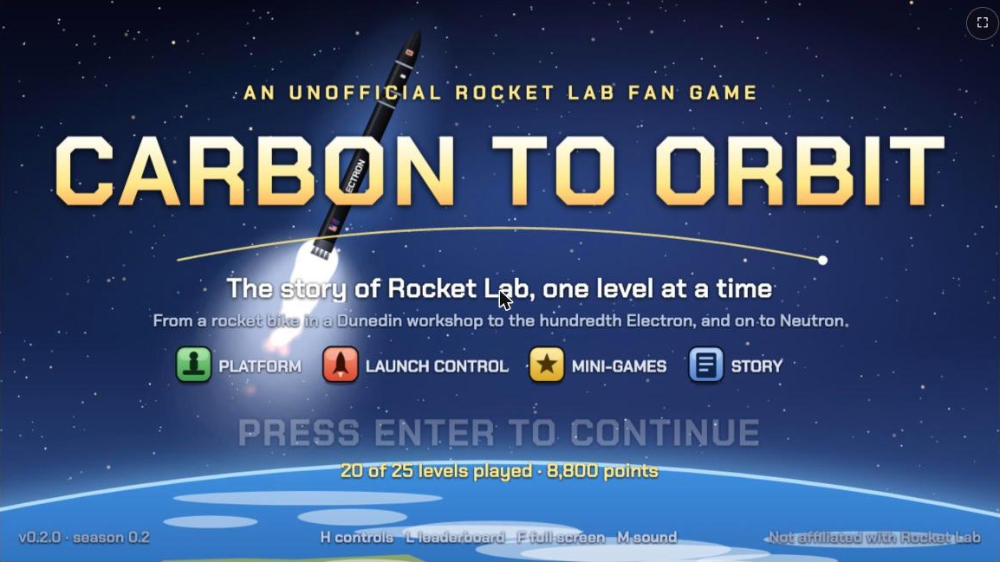
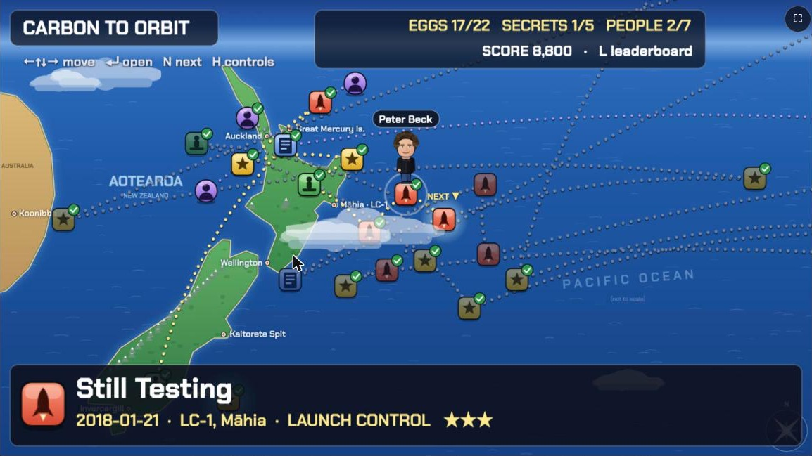
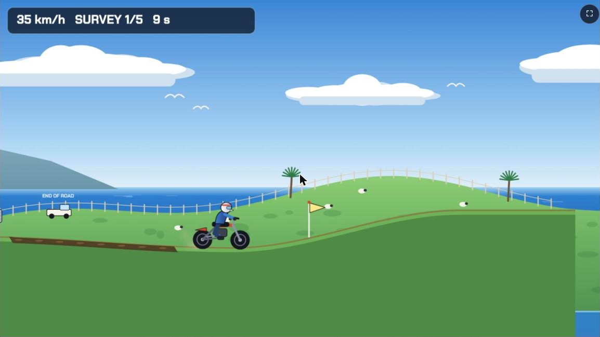

<div align="center">



# Carbon to Orbit

**The story of Rocket Lab, one level at a time.**<br>
From a rocket bike in a Dunedin workshop to the hundredth Electron, and on to Neutron.

An unofficial, open-source browser game. Fan project, not affiliated with Rocket Lab.

`25 playable levels` · `14 kinds of play` · `every fact sourced` · `no image or audio files: it is all code`

</div>

---

## What it is

You walk a world map through thirty years of Rocket Lab history. Every stop is a real moment, and each one plays differently:

| | |
| --- | --- |
| **Platform levels** | Build the rocket bike after hours at the appliance factory. Haul pad hardware down the coast road to Māhia. Carry the Nasdaq listing across Long Beach as the CFO. |
| **Launch control** | A real ascent simulation for people who know the vocabulary: call the go/no-go poll, fly the pitch program on a flight director, throttle through Max-Q, command staging, fairing and the battery hot-swap, cut off on apogee, circularise with the kick stage. |
| **Mini-games** | Catch a booster with a helicopter. Stretch an orbit to the Moon. Find the fault on flight 13. Bring Varda's capsule down in the outback. Run two launch counts in two hemispheres at once. |
| **Story cards and people** | The founding, the knighthood, and the people who were there, each with sources and, where one exists, a freely licensed photo. |

<div align="center">
 
 
</div>

Every level ends with what really happened, hides an easter egg, and links its sources.

## Play it

```bash
npm install
npm run dev
```

Open the address Vite prints. Press **H** at any moment for the controls of whatever you are doing.

| Key | Does |
| --- | --- |
| Arrows (or W A S D) | Move, steer, pitch, choose |
| Space (or Z) | Jump, burn, the next step in a sequence |
| Enter (or X) | Confirm, hold the count, engine cutoff |
| H | Controls for the current level or the map |
| L | Your score and the leaderboard |
| N | On the map: walk to the next level |
| F | Full screen |
| M | Sound on or off |

A touch pad appears on phones.

## The levels

| Kind | Levels |
| --- | --- |
| Platform | The Rocket Bike · Road to Māhia · Rosie the Robot · RKLB rings the bell (played as Adam Spice) · Archimedes and the tank |
| Launch control | Ātea-1 · It's a Test · Still Testing · It's Business Time · Virginia Is For Launch Lovers · Scout's Arrow (HASTE) · Paschen's Law · Beginning Of The Swarm · The Mountain God Rises |
| Mini-game | Rutherford hot-fire · Go Find the Launch Site (played as Shaun D'Mello) · Pics Or It Didn't Happen · Return To Sender · There And Back Again · CAPSTONE to the Moon · Two Hemispheres · Outback Delivery · ESCAPADE · VICTUS HAZE |
| Story | Rocket Lab is founded · Sir Peter · Neutron (locked until it flies) |
| People to meet | Mark Rocket and Sir Stephen Tindall · Ky Michaelson · Sir Michael Fay · Dava Newman · Gabe Newell · Adam Spice · Rob Lillis |
| Secrets | Princes Street Sprint · Kaitorete Spit · Inside the first hundred · Photon · The Hungry Hippo |

## Contribute, with or without an agent

The game is built so that a new level is mostly data plus drawing code, and so that an AI coding agent can add one end to end.

- **With an agent:** open the repository in your agent and ask for what you want, for example *"add a level about the first Neutron hot-fire"*. The repository ships a skill, [`.claude/skills/add-level`](.claude/skills/add-level/SKILL.md), that walks the agent through research, building, testing with the level's bot, and a fan review. [`AGENTS.md`](AGENTS.md) points any agent at it.
- **By hand:** the same steps are written for people too. Start with [docs/ARCHITECTURE.md](docs/ARCHITECTURE.md), then the skill.

Three rules keep the game worth playing:

1. **True.** Every fact on screen has a source. Real people are shown in their public role and are never given invented words.
2. **Its own place.** No level reuses another's backdrop, and enemies and power-ups belong to that chapter of the story.
3. **Something new to do.** Each level adds a thing the player has not done before. If the story needs a new kind of play, build it as a reusable mechanic.

The full brief, including the level backlog, is in [docs/PROJECT_SPEC.md](docs/PROJECT_SPEC.md).

## Under the hood

- **Vite, TypeScript, Phaser 3.** Static and client-only.
- **All art is drawn in code** with the Canvas 2D API, and **all sound is synthesised** with Web Audio. There are no sprite sheets and no audio files.
- **Launch control runs a physical model**: a point mass around a round Earth with real gravity, thrust, drag and orbital elements. `npm run sim` flies it headless.
- **Every level has a bot.** `?level=<id>&auto=1` plays a level to prove it can be won.

### Developer tools

| | |
| --- | --- |
| Developer mode | The switch in the page footer (or `?dev=1`): every level open, `K` skips one |
| `?level=<id>` | Jump straight into a level, for example `?level=capstone` |
| `?level=<id>&auto=1` | Let the bot play it; add `&fast=6` to run six times faster |
| `?level=<id>&auto=1&rec=<name>` | Record the run to `recordings/<name>.webm` (dev server only) |
| `npm run sim` | Fly the launch physics with the autopilot and print timelines and margins |
| `npm run build` | Type-check and build |

## Score, seasons and the leaderboard

Your score is stars, easter eggs, secrets and people met. Press **L** to see it.

Scores are grouped by **season**, the major.minor of the game version, so a board never mixes players who had different levels to play. The version is on the title screen.

The online leaderboard is optional and runs on a small Cloudflare Worker with a D1 database. Without one, the game shows only your own score. Setup is in [leaderboard/README.md](leaderboard/README.md).

## Official patches and photos (optional, your copy only)

This repository contains no official Rocket Lab media. For your own play, the game will show a mission patch on the fairing and on a level's cards if you save it as `src/assets/patches/<level id>.png`, and an official photo on a level's cards if you save it as `src/assets/official/<level id>.jpg`. Both folders are git-ignored. Patches are on each mission's page at rocketlabcorp.com/missions/launches; photos are on Rocket Lab's Flickr, which asks for credit and marks them all rights reserved.

## Licence and credits

- **Code:** MIT, see [LICENSE](LICENSE).
- **Story text and generated artwork:** CC BY-SA 4.0.
- **Photos on story cards:** freely licensed images from Wikimedia Commons, each credited in [public/assets/photos/CREDITS.md](public/assets/photos/CREDITS.md).

Rocket Lab, Electron, Neutron and the mission names belong to Rocket Lab. This project is a tribute by fans and is not endorsed by the company. If you are shown in the game and would like to be removed, open an issue.
