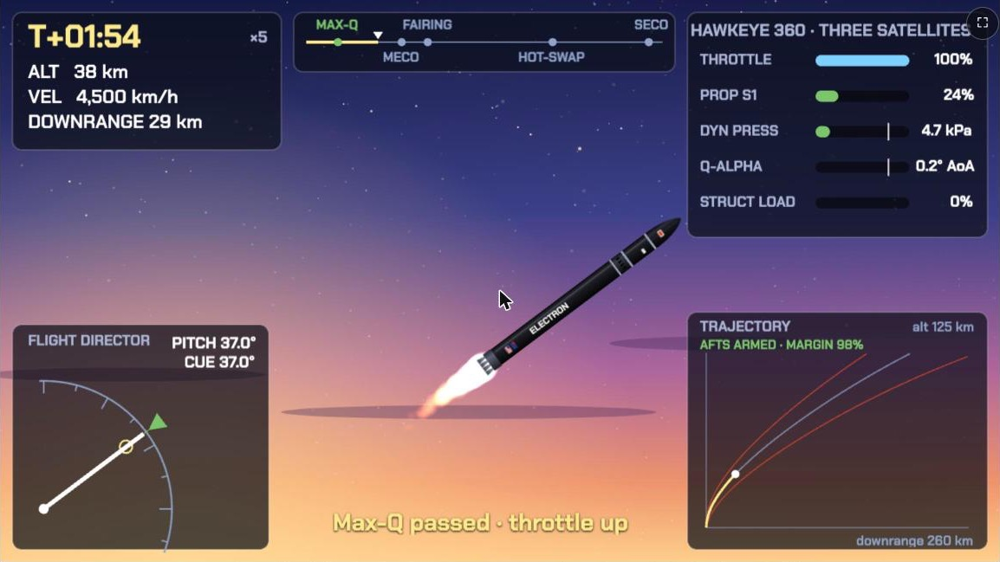
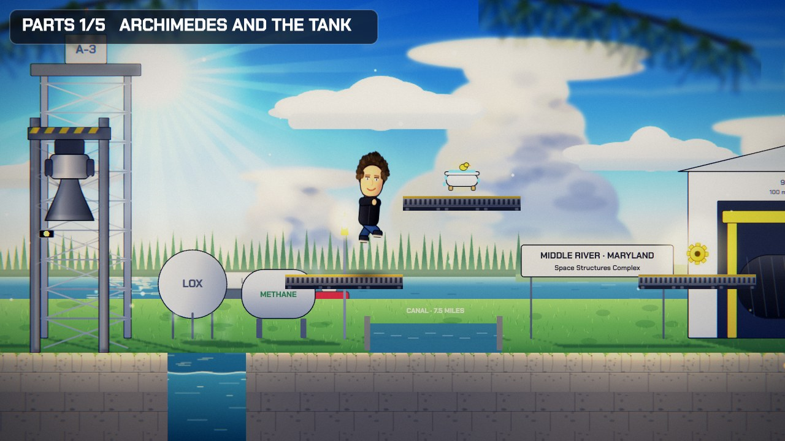

<div align="center">


# Carbon to Orbit

**The story of Rocket Lab, one level at a time.**<br>
From a rocket bike in a Dunedin workshop to the hundredth Electron, and on to Neutron.

An unofficial, open-source browser game. Fan project, not affiliated with Rocket Lab.

<!-- counts:start: written by `npm run readme` -->
`29 playable levels` · `17 kinds of play` · `every fact sourced` · `art and sound made in code`
<!-- counts:end -->

</div>

---

## What it is

You walk a world map through thirty years of Rocket Lab history. Every stop is a real moment, and each one plays differently:

| | |
| --- | --- |
| **Platform levels** | Build the rocket bike after hours at the appliance factory. Haul pad hardware down the coast road to Māhia. Carry the Nasdaq listing across Long Beach as the CFO. Walk into mission control before dawn for Electron's 50th launch. |
| **Launch control** | A real ascent simulation for people who know the vocabulary: call the go/no-go poll, fly the pitch program on a flight director, throttle through Max-Q, command staging, fairing and the battery hot-swap, cut off on apogee, circularise with the kick stage. |
| **Mini-games** | Catch a booster with a helicopter. Stretch an orbit to the Moon. Find the fault on flight 13. Bring Varda's capsule down in the outback. Run two launch counts in two hemispheres at once. Cut a creator interview into four parts for four channels. |
| **Story cards and people** | The founding, the knighthood, and the people who were there, each with sources and, where one exists, a freely licensed photo. |

<div align="center">
 
 
</div>

Every level ends with what really happened, hides an easter egg, and links its sources.

## Play it

```bash
npm install
npm run dev
```

Open the address Vite prints. Press **H** at any moment for the controls of whatever you are doing.

| Key | Does |
| --- | --- |
| Arrows (or W A S D) | Move, steer, pitch, choose |
| Space (or Z) | Jump, burn, the next step in a sequence |
| Enter (or X) | Confirm, hold the count, engine cutoff |
| + and − | Game speed inside a level, from ×0.5 to ×4. Faster scores more, slower scores less |
| H | Controls for the current level or the map |
| Esc | In a level: back to the map (the ⌂ button too; it asks first) |
| I | A hint, in levels that have them (the 💡 button too) |
| L | Your score and the leaderboard |
| N | On the map: walk to the next level |
| P | Free play: every level, card and person open, picked from a list (the ☰ button or the footer switch too). Nothing is scored or saved |
| F | Full screen |
| M | Sound on or off |
| T | Next soundtrack: the original score, 1980s synthwave, chiptune, or slow and cinematic |
| G | Graphics: high (HD), with lighting, reflections and glow in levels that have it, or standard (SD) for slower computers |

A touch pad appears on phones.

## The levels

<!-- levels:start: written by `npm run readme` from src/content.ts; do not edit by hand -->
All 36 stops on the map, in story order:

| # | Level | Year | Where | Play |
| --- | --- | --- | --- | --- |
| 1 | The Rocket Bike | 1995–2000 | Dunedin, Aotearoa New Zealand | Platform |
| 2 | Rocket Lab is founded | 2006 | Auckland | Story card |
| 3 | Ātea-1 | 2009 | Great Mercury Island | Launch control |
| 4 | Rutherford hot-fire | 2013–2016 | Auckland test stand | Mini-game: engine hot-fire |
| 5 | Go Find the Launch Site (played as Shaun D’Mello) | about 2015 | Māhia Peninsula | Mini-game: off-road ride |
| 6 | Road to Māhia | 2016 | Māhia Peninsula | Platform |
| 7 | It’s a Test | 2017 | LC-1, Māhia | Launch control |
| 8 | Still Testing | 2018 | LC-1, Māhia | Launch control |
| 9 | It’s Business Time | 2018 | LC-1, Māhia | Launch control |
| 10 | Rosie the Robot (with Ashlee Vance as a running mate) | 2019 | Auckland production complex | Platform |
| 11 | Pics Or It Didn’t Happen | 2020 | LC-1, Māhia → mission control, Auckland | Mini-game: failure investigation |
| 12 | Return To Sender | 2020 | Pacific Ocean, downrange of Māhia | Mini-game: capsule recovery |
| 13 | Eating the Hat | 2021 | Long Beach, California | Mini-game: blend and eat a hat |
| 14 | RKLB rings the bell (played as Adam Spice; with Peter Beck as a running mate) | 2021 | Long Beach, California | Platform |
| 15 | There And Back Again | 2022 | Pacific Ocean, off Māhia | Mini-game: helicopter catch |
| 16 | CAPSTONE to the Moon | 2022 | LC-1 → lunar transfer | Mini-game: orbit raising |
| 17 | Virginia Is For Launch Lovers | 2023 | LC-2, Wallops Island, Virginia | Launch control |
| 18 | When the Heavens Went on Sale | 2023 | New York | Story card |
| 19 | Markets with Madison | 2023 | NZ Herald, Auckland | Story card |
| 20 | Scout’s Arrow | 2023 | LC-2, Wallops Island, Virginia | Launch control |
| 21 | Paschen’s Law | 2023 | LC-1, Māhia | Launch control, then lab experiment |
| 22 | Beginning Of The Swarm | 2024 | LC-1, Māhia | Launch control |
| 23 | Sir Peter | 2024 | Aotearoa New Zealand | Story card |
| 24 | No Time Toulouse (with Madison Malone as a running mate) | 2024 | Rocket Lab mission control, Mount Wellington, Auckland | Platform |
| 25 | Wild Wild Space | 2024 | HBO and Max | Story card |
| 26 | Four channels, one call | 2024 | YouTube | Mini-game: edit an interview |
| 27 | Forbes counts a billionaire | 2024 | Forbes estimate | Story card |
| 28 | Two Hemispheres | 2024 | LC-2, Wallops and LC-1, Māhia | Mini-game: two launch counts |
| 29 | Outback Delivery | 2025 | Low Earth orbit → Koonibba, South Australia | Mini-game: spacecraft burns |
| 30 | ESCAPADE | 2025 | Earth → Sun–Earth L2 → Mars | Mini-game: cruise to Mars |
| 31 | Seven diaries, one slot (played as Mrs. Iglesias) | 2026 | YouTube | Mini-game: find a meeting slot |
| 32 | Five channels, one Q&A | 2026 | YouTube | Story card |
| 33 | VICTUS HAZE | 2026 | LC-1, Māhia | Mini-game: race the count |
| 34 | The Mountain God Rises | 2026 | LC-1, Māhia | Launch control |
| 35 | Archimedes and the tank | 2024–2026 | Stennis → Middle River → Wallops | Platform |
| 36 | Neutron: first flight (locked until it flies) | no earlier than 2027 | LC-3, Wallops Island, Virginia | Launch control |

Secrets, unlocked by finding a hidden blueprint:

| Secret | Play | Found in |
| --- | --- | --- |
| Princes Street Sprint | Mini-game: street sprint | The Rocket Bike |
| Kaitorete Spit: the first choice | Story card | Road to Māhia |
| Photon: the kick stage grows up | Story card | Rosie the Robot |
| The Hungry Hippo arrives | Story card | Archimedes and the tank |
| Kinéis: five for five | Story card | No Time Toulouse |
| Inside the first hundred | Story card | Go Find the Launch Site |

People to meet, on small nodes beside the path:

| Person | Year | Beside |
| --- | --- | --- |
| Mark Rocket and Sir Stephen Tindall | 2006–2007 | Rocket Lab is founded |
| Ky “Rocketman” Michaelson | 2006 | Rocket Lab is founded |
| Sir Michael Fay | 2009 | Ātea-1 |
| Dava Newman | 2016 | Rutherford hot-fire |
| Gabe Newell | 2020 | Return To Sender |
| Rob Lillis | 2025 | ESCAPADE |
| Madison Malone | 2024 | Sir Peter |
| Vince is Bullish | 2024 | Four channels, one call |
| Dave G | 2024 | Four channels, one call |
| Matt Farley | 2024 | Four channels, one call |
| Scott O | 2024 | Four channels, one call |
| Mrs. Iglesias | 2026 | Seven diaries, one slot |
| Adam Spice | 2018– | RKLB rings the bell |
<!-- levels:end -->

## Contribute, with or without an agent

The game is built so that a new level is mostly data plus drawing code, and so that an AI coding agent can add one end to end.

- **With an agent:** open the repository in your agent and ask for what you want, for example *"add a level about the first Neutron hot-fire"*. The repository ships a skill, [`.claude/skills/add-level`](.claude/skills/add-level/SKILL.md), that walks the agent through research, building, testing with the level's bot, and a fan review. [`AGENTS.md`](AGENTS.md) points any agent at it.
- **By hand:** the same steps are written for people too. Start with [docs/ARCHITECTURE.md](docs/ARCHITECTURE.md), then the skill.

Three rules keep the game worth playing:

1. **True.** Every fact on screen has a source. Real people are shown in their public role and are never given invented words.
2. **Its own place.** No level reuses another's backdrop, and enemies and power-ups belong to that chapter of the story.
3. **Something new to do.** Each level adds a thing the player has not done before. If the story needs a new kind of play, build it as a reusable mechanic.

The full brief, including the level backlog, is in [docs/PROJECT_SPEC.md](docs/PROJECT_SPEC.md).

Changes come in as pull requests and are reviewed by the maintainer before they are merged; nothing is pushed straight to `main`. The rules GitHub enforces are in [.github/rulesets/main.json](.github/rulesets/main.json).

## Contributors

| | | |
| --- | --- | --- |
| [@tommasogritti](https://github.com/tommasogritti) | Started the project and maintains it | [X](https://x.com/tommasogritti) |

The same list is in the game: **Credits** in the page footer, or **C** on the title screen and the map. When your first pull request is merged, add yourself to [src/contributors.ts](src/contributors.ts) and to this table.

## Under the hood

- **Vite, TypeScript, Phaser 3.** Static and client-only.
- **All art is drawn in code** with the Canvas 2D API, and **all sound is synthesised** with Web Audio. There are no sprite sheets and no audio files; the only images are the official mission patches and a few credited photos.
- **Launch control runs a physical model**: a point mass around a round Earth with real gravity, thrust, drag and orbital elements. `npm run sim` flies it headless.
- **Every level has a bot.** `?level=<id>&auto=1` plays a level to prove it can be won.

### Developer tools

| | |
| --- | --- |
| Free play | `P`, the ☰ button or the footer switch (or `?free=1`): every node open, a list to pick from, nothing scored or saved |
| Developer mode | `npm run dev` only, not in the deployed game: the switch in the page footer (or `?dev=1`) opens every level, and `K` skips one |
| `?level=<id>` | Jump straight into a level, for example `?level=capstone` |
| `?level=<id>&auto=1` | Let the bot play it; add `&fast=6` to run six times faster |
| `?level=<id>&auto=1&rec=<name>` | Record the run to `recordings/<name>.webm` (dev server only) |
| `&recmix=sfx`, `&clean=1` | With `rec`: record sound effects without music. Anywhere: leave out mission patches and local official photos |
| `npm run sim` | Fly the launch physics with the autopilot and print timelines and margins |
| `npm run build` | Type-check and build |

## Score, seasons and the leaderboard

Your score is level points, easter eggs, secrets and people met. A level is worth its stars × 100 at normal speed, more if you play it faster (×1.5 at double speed, ×2 at four times) and less if you slow it down (×0.5 at half speed); your best run of each level counts. Press **L** to see it.

Scores are grouped by **season**, the major.minor of the game version, so a board never mixes players who had different levels to play. The version is on the title screen.

The online leaderboard is optional and runs on a small Cloudflare Worker with a D1 database. Without one, the game shows only your own score. Setup is in [leaderboard/README.md](leaderboard/README.md).

## Mission patches and official photos

Each level about a Rocket Lab mission shows that mission's official patch on its cards, and launch levels paint it on the fairing. The patches are Rocket Lab's artwork, taken from each mission's page at rocketlabcorp.com/missions/launches; every card credits Rocket Lab and links the page, and [src/assets/patches/patches.json](src/assets/patches/patches.json) lists them all.

Official photos are not in the repository. For your own play, save one as `src/assets/official/<level id>.jpg` (git-ignored) and it shows on that level's cards. Rocket Lab's Flickr asks for credit and marks its photos all rights reserved.

## Privacy

The game sets no cookies and asks for nothing. The public site counts visits with Cloudflare Web Analytics, which is cookie-free and does not track individuals. The game also sends an anonymous count when a level starts and ends (the season, the level, finished or not, and the stars), which the leaderboard Worker adds to a daily total; nothing identifies a player. Nothing is sent when your browser asks sites not to track it (Do Not Track or Global Privacy Control), in developer mode, or from a copy without a leaderboard. The code is [src/stats.ts](src/stats.ts).

## Licence and credits

- **Code:** MIT, see [LICENSE](LICENSE).
- **Story text and generated artwork:** CC BY-SA 4.0.
- **Mission patches:** © Rocket Lab, not covered by the licences above; each card links its source.
- **Photos on story cards:** freely licensed images from Wikimedia Commons, each credited in [public/assets/photos/CREDITS.md](public/assets/photos/CREDITS.md).

Rocket Lab, Electron, Neutron and the mission names belong to Rocket Lab. This project is a tribute by fans and is not endorsed by the company. If you are shown in the game and would like to be removed, open an issue.
